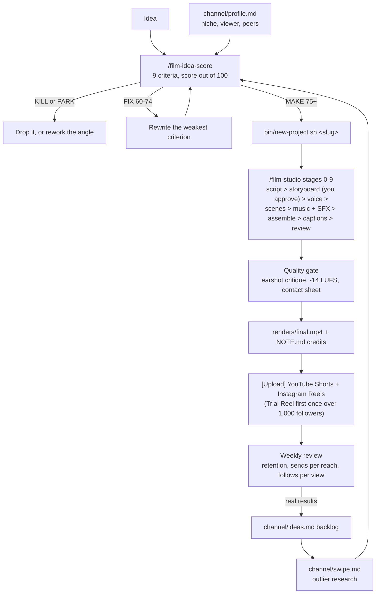

# film-studio-agents

A video studio run by AI coding agents (Claude Code and any tool that reads `AGENTS.md`). Each film is code (HTML, React, Three.js) rendered to MP4, with a local voice and code-made sound.

Ask for a film; the `film-studio` skill writes the story, voices it, builds each scene with the best-fitting video skill, mixes the sound, adds captions and checks the result.

## Demo

The studio launch film, made by the studio itself (47 s, vertical, narrated):


[Full video with sound: `docs/launch.mp4`](docs/launch.mp4) (the GIF is silent; this is a 720p copy, the full-quality master stays local at `projects/2026-11-20-studio-launch/renders/final.mp4`).

## Desktop app (Film Studio)

```bash
bin/studio.sh            # builds the release app on first run (a few minutes), then opens it
bin/studio.sh --rebuild  # force a fresh release build
```

A Tauri app (Rust + TypeScript, in `studio/`) that drives the pipeline with any agent CLI:

- **Agents:** Claude Code, Codex, Antigravity, or any command (`$PROMPT` holds the prompt). Pick the model and effort per agent.
- **What the agent may do:** *Read only*, *Guarded* (default: edits plus a safety check on commands) or *Full access* (no checks). Full access asks you to confirm, shows a red banner while on, and resets to Guarded each launch. The exact command and flags are the first line of every run log.
- **Progress:** the 11 stages (0 Brief to 9 Cleanup) as a film-leader strip, read from the files each stage writes. It looks the same whichever agent is working. Click a stage to see what it does and which files prove it. Facts, Scenes (render state, play a clip) and Script tabs.
- **Gates in the app:** at G1 (script and storyboard) and other user gates, the agent writes `.studio/gate.json` and stops. The app shows the question, the files to read, and Approve or Request changes, then resumes the agent with your answer.
- **Switch agents mid-film:** every run is logged to `.studio/run.log`, and the agent keeps `.studio/handoff.md`. If a run fails (say Antigravity stops halfway), pick another agent and press *Resume*: it reads the note and the log, checks the files, and continues from the first stage that does not pass.
- **Lean run** (on by default): drops MCP servers the pipeline never uses (only Earshot stays) and asks the agent to read only what each stage names. Same pipeline, fewer tokens. A per-film token and cost meter shows the effect.
- **Intro and chapter bridges:** a checkbox on the new-film form that applies the `film-framing` skill.

Develop with hot reload: `cd studio && pnpm install && pnpm tauri dev`. Rust tests: `cd studio/src-tauri && cargo test`. Linux needs webkit2gtk-4.1 and the GStreamer libav plugin (`gst-inspect-1.0 avdec_h264`) to play H.264 in the app.

## Quick start (agent in a terminal)

```bash
bin/new-project.sh my-film        # makes projects/<date>-my-film/ from templates/project/
# then, in your agent: /film-studio  "a 60 s explainer about ..."
```

Before making a channel video, score the idea: `/film-idea-score "idea"`. Narrated film: `/film-studio`. Music-led film with no speech: `/film-studio-nospeech`. Captions on any video: `/film-captions`. Intro, chapter cards and smooth topic changes for long films: add `/film-framing`.

## Skills

Project skills live in `.agents/skills/` (the real files). `.claude/skills/` and `.hermes/skills/` hold relative symlinks to every one of them, so Claude Code, Hermes and any `AGENTS.md` tool find the same set. Add a new project skill to `.agents/skills/`, then symlink it into both.

### Studio skills (ours)

| Skill | Use it for |
|---|---|
| `film-studio` | A whole narrated film: story, script, voice, scenes from several skills, music, captions, quality checks. The default for any finished video. |
| `film-studio-nospeech` | A whole film with no narration, cut to the beat of a music track. |
| `film-framing` | Intro, chapter bridges and outro for films with topic sections (add-on to `film-studio`). |
| `film-captions` | Word-timed captions on any video (clean, karaoke, box, punch). The only skill that adds captions. Spoken numbers of 10+ show as digits. |
| `film-outro` | The channel's 2 s outro, built once and cached, then appended to any reel with one command. |
| `film-idea-score` | Score a Reel/Short idea out of 100 before making it (MAKE / FIX / PARK / KILL). |

### Design skills

| Skill | Use it for |
|---|---|
| `ui-ux-pro-max` | Styles, palettes, font pairings and UX rules, searchable (`scripts/search.py`). Used for each film's `style.md`. |
| `design-system` | Three-layer design tokens (primitive, semantic, component), CSS variables, slide generation. |
| `design` | Brand identity, tokens, logo and corporate-identity generation (the logo/CIP generators call Gemini; optional). |
| `brand` | Brand voice, visual identity, messaging, asset checks. |
| `banner-design` | Banners and covers for social, ads, website heroes and print. |
| `slides` | HTML presentations with Chart.js and design tokens. |
| `ui-styling` | shadcn/ui + Tailwind interfaces, accessible components, canvas visuals. |

### Remotion skills (only when the user or client asks for Remotion)

| Skill | Use it for |
|---|---|
| `remotion-best-practices` | Router for all Remotion skills. |
| `remotion-create` | Start a new Remotion video. |
| `remotion-markup` | Content, animation and effects best practices. |
| `remotion-interactivity` | Make layers, timing and styles editable in Remotion Studio. |
| `remotion-captions` | Transcribe, display and animate captions (not used in films: captions go through `film-captions`). |
| `remotion-maps` | Map animations (Cesium, MapTiler). |
| `remotion-multimedia` | Audio and video handling with Mediabunny. |
| `remotion-render` | Export a video, still or OpenTimelineIO timeline. |
| `remotion-studio` | Preview a Remotion video. |
| `remotion-docs` | Search the Remotion docs. |
| `remotion-license` | Licence terms (free for individuals and companies of 3 or fewer). |
| `remotion-saas` | Build an app with Remotion. |
| `remotion-upgrade` | Upgrade Remotion and its packages. |

### Video skills installed outside the repo (`bin/setup-skills.sh all`)

| Skill | Use it for | Where |
|---|---|---|
| HyperFrames (`/hyperframes`) | General scenes, edits, render and preview (the fallback engine) | `~/.claude/skills/` |
| Shotcraft (`video-shotcraft`) | Product promos built from a real website or app UI | `~/.claude/skills/` |
| Motionmaxxing (`/motionmaxxing`) | Launch films, brand stings, kinetic type | `~/.claude/skills/` |
| Lemo-Opuscar (`/lemo-opuscar:lemo-opuscar`) | Narrated films in one of 99 named looks (watercolor, woodcut, news...) | Claude plugin |
| 3DViz Pro Max (`/3dviz-pro-max`) | 3D hero scenes and STEM explainers (Three.js) | `~/.claude/skills/` |
| Earshot (`earshot` CLI / MCP) | Pick and make SFX, check sync and loudness, critique the mix | CLI + MCP |
| Herk Edit Kit | Edit your own recordings (cut silences and mistakes, 9:16 reels) and 406 editorial card scenes | `~/.local/share/skill-src/herk-edit-kit` |
| OpenMontage (via `bin/om.sh`) | Real stock footage scenes (NASA, Wikimedia, Archive.org...), grading, reframing | `~/.local/share/skill-src/OpenMontage` |

Which skill does which job, licences and install state: the registry in `CLAUDE.md` and one card per skill in `research/skills/`.

## How a film is made

`story + script` > `storyboard + recipe per scene` (you approve) > `voice + timing` > `scenes` > `music + SFX` > `assemble` > `captions` > `review` > `deliver`.

Every scene carries a `recipe` in `plan.json`: the blueprint, registry blocks, camera move, shot card, Lemo style, 3D record, Herk card or OpenMontage footage clip it uses. `scene_check.py` refuses a scene with a missing or invented recipe, a wrong size, or more than 40% frozen frames.

## Full flow

From idea to posted video and back. Steps in brackets are not built yet.



1. **Score the idea.** `/film-idea-score "your idea"` (or a list to rank). It reads `channel/profile.md`, checks `channel/swipe.md` for proof, rates nine criteria, runs `score.py` and logs the result to `channel/ideas.md`. Verdicts: MAKE at 75 or more, FIX at 60 to 74 (rewrite the weakest part and rescore), PARK under 60, KILL on any dealbreaker (no own angle, or the studio cannot make it).
2. **Make the film.** `bin/new-project.sh <slug>`, then `/film-studio` with the winning hook. Vertical 1080x1920, 15 to 60 s, captions on.
3. **Check it.** Earshot critique, loudness at -14 LUFS, true peak at -1 dBTP or lower, contact sheet.
4. **Post it.** By hand for now. Same file to YouTube Shorts and Instagram Reels. Mark synthetic voice as altered or synthetic content; credit Kyutai if Pocket TTS was used.
5. **Learn.** Every week, add real results to `channel/ideas.md`. Those results become the proof for the next scores.

The growth plan behind this (which outside skills to add, what each platform rewards, the week-by-week roadmap): `research/viral-roadmap.md`.

## Layout

| Path | What it holds |
|---|---|
| `AGENTS.md` / `CLAUDE.md` | Rules, skill router, pipeline. `AGENTS.md` is a symlink to `CLAUDE.md`. |
| `.agents/skills/` | All project skills (film-*, design, remotion-*). `.claude/skills/` and `.hermes/skills/` link here. |
| `research/` | Dated notes: one card per skill, TTS, licences, money plan. |
| `projects/<date>-<slug>/` | One folder per film: `plan.json`, script, storyboard, scene sources. |
| `templates/project/` | Skeleton for new projects. |
| `assets/` | Shared media, each file logged in `assets/LEDGER.md` with source and licence. |
| `business/` | Paid work: leads and clients. Local only, not in git. |
| `todo/` | What to make next: one file per planned video, in order (`todo/README.md`). Local only, not in git. |
| `channel/` | Own Instagram + YouTube channel: `profile.md`, `swipe.md`, `ideas.md` (scored idea backlog). Local only, not in git. |
| `studio/` | Film Studio desktop app (Tauri: Rust in `src-tauri/`, TypeScript UI in `src/`). |
| `bin/` | `studio.sh` (open the app), `new-project.sh`, `vo.sh` (voice + word timings), `setup-skills.sh`, `clean.sh`. |

## Not in git

Personal folders (`business/`, `channel/`, `todo/`, `assets/brand/<name>/`) stay local. Rebuildable or heavy files are ignored (see `.gitignore`): `.venv/`, `node_modules/`, all audio and video (`renders/`, `build/`, `audio/`, scene `clip.mp4`), and copies the skills vendor into each scene. Regenerate a film from its `plan.json`, `script.md` and scene sources.

## Setup

- Machine used: 8 cores, 31 GB RAM, GTX 1650, ffmpeg 7, Chrome, Node, Python 3.11/3.12 via `uv`.
- Python env: `.venv/` with kokoro-onnx, pocket-tts and CPU torch (see `research/tts.md`).
- Install the video skills: `bin/setup-skills.sh all` (HyperFrames, Shotcraft, Motionmaxxing, 3DViz, Earshot, Lemo-Opuscar, Remotion, Herk Edit Kit, OpenMontage). They install into `~/.claude/` or `~/.local/share/skill-src/`, not this repo.
- Every `npx hyperframes` command needs `export HYPERFRAMES_CACHE_DIR=$HOME/.local/share/hyperframes-cache`.
- Self-test of the film scripts (about 35 s): `.agents/skills/film-studio/scripts/selftest.sh`.
- Self-test of the idea scorer: `python3 .agents/skills/film-idea-score/scripts/score.py --selftest`.

## Voice and licences

Only two voices are allowed: Kokoro-82M (Apache-2.0) and Pocket TTS (Kyutai, CC BY 4.0, credit Kyutai). Both run locally through `bin/vo.sh`. Skill and licence details: `research/licenses.md`. No third-party logo or character in paid work without rights.
